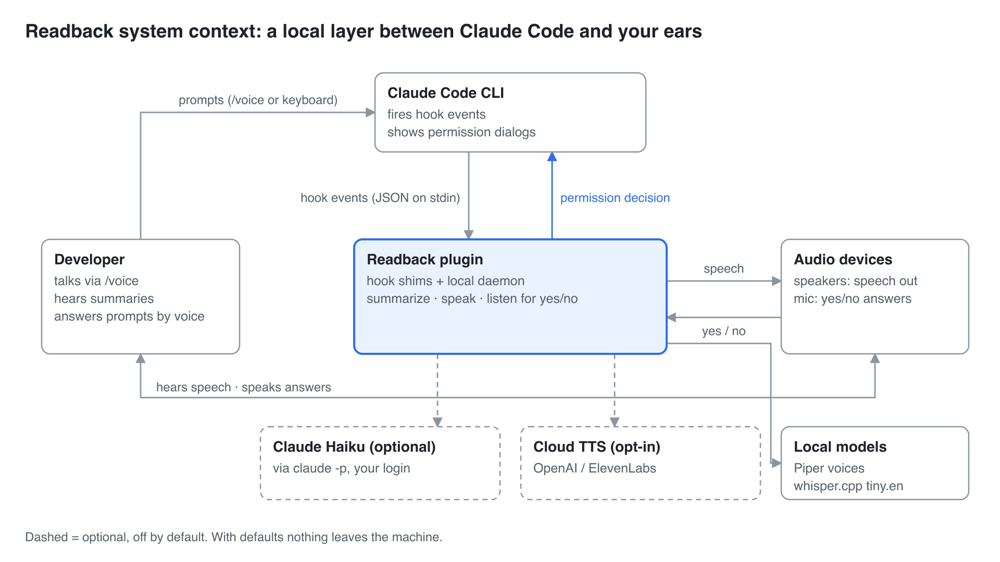

# Readback

**Hear Claude Code.** Readback is a free, open-source Claude Code plugin that speaks a one- or two-sentence summary when Claude finishes, tells you when Claude needs you, and lets you approve or deny permission prompts by voice.

> Status: **design complete, not yet built.** The specs are in [`docs/`](docs/).

```
You:      (hold space) "Add rate limiting to the login route and run the tests."
Readback:  "Claude wants to run npm test. Allow?"
You:      "Allow."
Readback:  "Added a rate limiter to the login route. Tests pass. Want me to commit?"
```

## How it works

- **You talk** with Claude Code's built-in `/voice` dictation.
- **Readback speaks** through Claude Code hooks: a short summary at the end of each turn, plus alerts when Claude is idle or needs permission. It never reads code, diffs or paths aloud.
- **You answer permission prompts by voice:** "allow", "deny", or "show me". Anything unclear, and any protected command, falls back to the normal keyboard dialog.
- **Stop it** with `/readback:stop`, or by sending any prompt.
- **Local by default.** It uses your system voice (`say` on macOS, Piper on Linux), and nothing leaves your machine.



## Status

**M1 alpha (macOS).** Spoken turn summaries, attention alerts, `/readback:*` commands and voice approval all work, and pass the live acceptance run (`spike/run_m1_live.py`). The marketplace install arrives with v0.1.

## Try it (alpha)

```bash
git clone https://github.com/badedokun/readback && cd readback
brew install sox whisper-cpp          # only needed for voice approval
claude --plugin-dir "$PWD"            # in any project
```

Then type `/readback:test`. The first session downloads the 75 MB speech model (pinned URL, SHA-256 checked). macOS asks your terminal for microphone access the first time you answer by voice.

When Claude asks for permission, Readback reads the request aloud. Say **"yes"** or **"no"**, or just answer on screen: the keyboard always wins. Destructive commands (`rm -rf`, `git push --force`, `sudo`, …) are never approved by voice.

## Develop

```bash
npm install            # dev only: typescript + @types/node for the type check
npm test               # unit, golden, contract and end-to-end tests (no audio)
npm run typecheck
python3 spike/run_m1_live.py   # live run: real Claude Code, speakers and mic (~5 min)
```

Readback has **no runtime dependencies**. It is plain ES modules with JSDoc types, so the plugin runs straight from the repository with no build step.

## Documentation

| Doc | Contents |
|---|---|
| [01 Requirements](docs/01-requirements.md) | Functional and non-functional requirements, speech rules, acceptance criteria |
| [02 Architecture](docs/02-architecture.md) | Context, components, hook map, flows, risks |
| [03 Detailed design](docs/03-detailed-design.md) | Hook contracts, IPC protocol, summarizer, queue, broker, listener, config |
| [04 Security and privacy](docs/04-security-privacy.md) | Voice-approval threat model, IPC, supply chain, privacy |
| [05 Test plan](docs/05-test-plan.md) | Golden corpus, traceability matrix, audio release gates |
| [06 Implementation plan](docs/06-implementation-plan.md) | Milestones M0–M3 with gates |
| [07 Release and operations](docs/07-release-and-operations.md) | Distribution, versioning, CI, support, troubleshooting |
| [ADRs](docs/adr/) | Key decisions and why |
| [Diagrams](docs/diagrams/) | SVG + PNG. Regenerate with `node docs/diagrams/src/build.mjs` |

## License

MIT. See [LICENSE](LICENSE).
