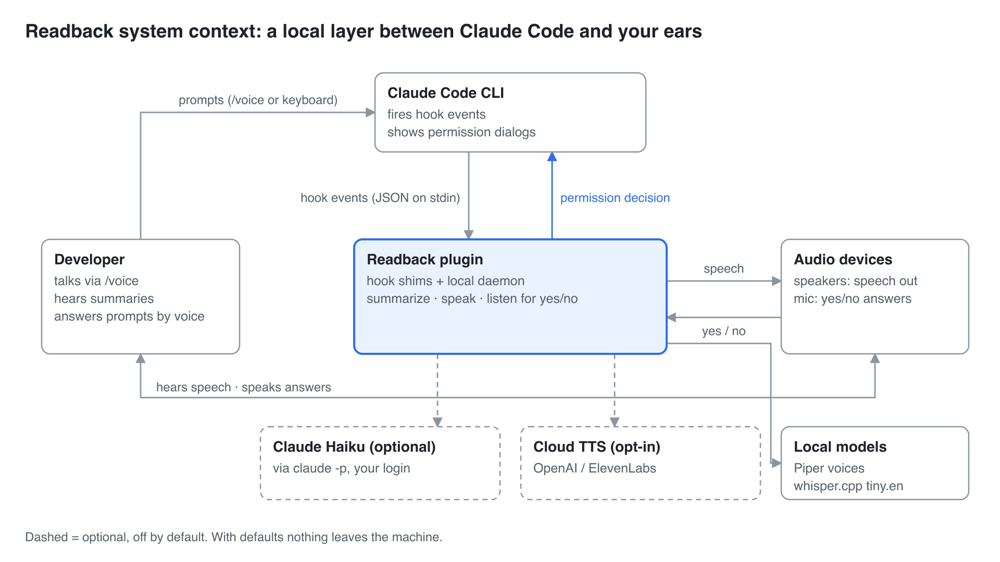
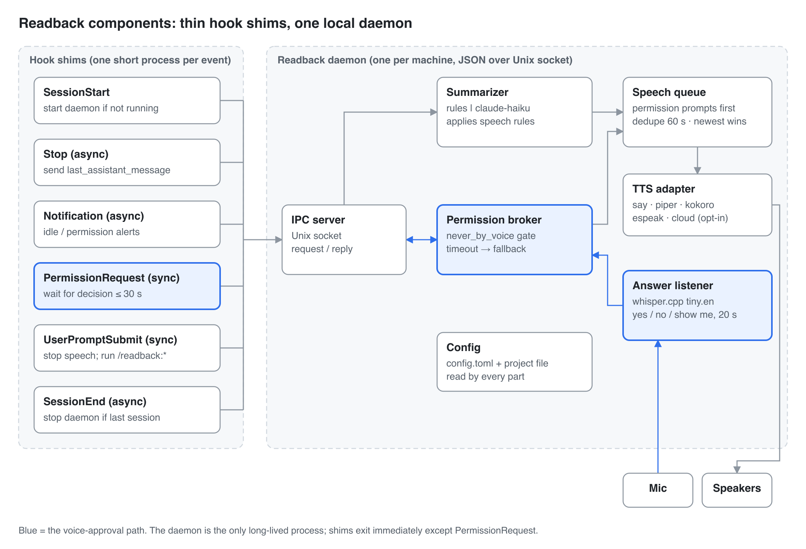
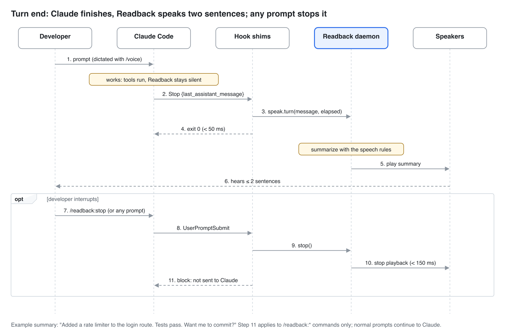
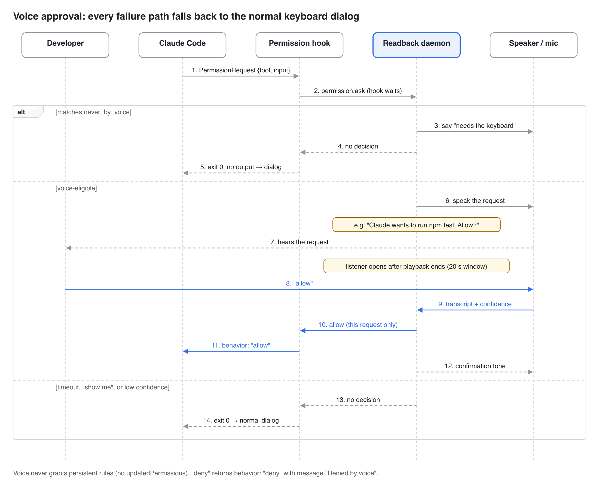

# Readback — Architecture Overview

| | |
|---|---|
| Version | 1.0 |
| Date | 2026-11-24 |
| Inputs | [01-requirements.md](01-requirements.md), the Claude Code hooks reference (https://code.claude.com/docs/en/hooks.md), verified 2026-11-24 |

## 1. Summary

Readback has two parts:

- **Hook shims.** Tiny Node scripts that Claude Code runs on hook events. Each one reads the event JSON from stdin, forwards it to the daemon, and exits.
- **Daemon.** One long-lived local process. It owns the summarizer, the speech queue, the voice engines and the answer listener.

Readback is not an MCP server, so Claude never spends a turn or tokens deciding to speak. Everything runs locally by default.

## 2. System context



| External system | Interaction |
|---|---|
| Claude Code CLI | Runs Readback's hooks. Receives permission decisions from the PermissionRequest hook. |
| Developer | Speaks prompts via native `/voice`. Hears summaries. Says "allow", "deny" or "show me" to permission prompts. |
| Audio devices | Speakers for speech. Microphone, used only during a permission answer window. |
| Local models | Piper voices (Linux TTS) and whisper.cpp `tiny.en` (answer listener). Downloaded on first use to `${CLAUDE_PLUGIN_DATA}`. |
| Claude Haiku (optional) | Smarter summaries via headless `claude -p --model haiku`, using the user's existing login. |
| Cloud TTS (optional) | OpenAI or ElevenLabs voices. Opt-in, with a warning that text leaves the machine. |

## 3. Components



| Component | Responsibility | Key requirements |
|---|---|---|
| Hook shims (`bin/readback-hook.mjs <event>`) | Parse stdin, start the daemon if needed, forward the event, return the hook output. | NFR-01, NFR-07 |
| IPC server | Unix socket at `${XDG_RUNTIME_DIR:-/tmp}/readback-$UID.sock`. Newline-delimited JSON request/reply. | NFR-01 |
| Summarizer | Turns `last_assistant_message` into speakable text using the speech rules. Two strategies: `rules` (default) and `claude-haiku`. | FR-01..03, §6 |
| Speech queue | Priority queue, de-duplication, barge-in, quiet hours. | FR-30..31, FR-42 |
| TTS adapter | Interface `speak(text, opts) → Playback` and `stop()`. Engines: `say`, `piper`, `kokoro`, `espeak-ng`, `openai`, `elevenlabs`. | FR-36, NFR-02 |
| Permission broker | Describes the request, applies the `never_by_voice` gate, runs the answer window and maps the answer to a decision. | FR-20..28 |
| Answer listener | Opens the mic only during the answer window. Runs whisper.cpp `tiny.en` and matches the result against a closed vocabulary. | FR-21, FR-26 |
| Config | Loads `~/.config/readback/config.toml`, then `.claude/readback.toml`. Hot-reloads on change. | FR-40..43 |

## 4. Hook map

| Hook event | Mode | Shim behaviour | Output to Claude Code |
|---|---|---|---|
| `SessionStart` | async | Ensure the daemon is running. Register the session. | none |
| `Stop` | async (`"async": true`) | Send `speak.turn` with `last_assistant_message`, `session_id` and `cwd`. | none |
| `Notification` | async | Send `alert` with `notification_type` and `message`. | none (Notification hooks cannot block) |
| `PermissionRequest` | sync, timeout 30 s | Send `permission.ask` and wait for the reply. | `hookSpecificOutput.decision` (allow/deny), or exit 0 with nothing → normal dialog |
| `UserPromptSubmit` | sync, timeout 2 s | Always send `stop`. If the prompt starts with `/readback:`, run the command locally and block it. | `{"decision":"block","reason":…,"suppressOriginalPrompt":true}` for `/readback:*`, else nothing |
| `SessionEnd` | async | Unregister the session. The daemon exits 5 min after the last session ends. | none |

Notes from verification (2026-11-24):

- The Stop input includes `last_assistant_message`. The docs advise using it rather than `transcript_path`, because the transcript may not contain the final message at Stop time. This matches the known flush-race issues reported in Claude Code issues #74340 and #15812. See [ADR-0003](adr/0003-use-last-assistant-message.md).
- `/stop` is a built-in Claude Code command, so Readback uses the namespaced `/readback:stop`. See [ADR-0004](adr/0004-stop-command-naming.md).
- No hook fires when `/voice` dictation starts. Barge-in therefore triggers on prompt submit or `/readback:stop`, not on the start of dictation.
- `async: true` hooks cannot return decisions, so only PermissionRequest and UserPromptSubmit are synchronous.

## 5. Key flows

### 5.1 Turn end


### 5.2 Voice approval


Design rule: **every failure path is "no decision".** If the daemon is down, the socket times out, the listener errors, recognition is unclear or the request matches `never_by_voice`, the shim exits 0 with no output, and Claude Code shows its normal dialog. Readback can deny or approve only after an explicit spoken answer.

## 6. Deployment and file layout

Readback is distributed as a Claude Code plugin from a GitHub marketplace:

```
claude plugin marketplace add <owner>/readback
claude plugin install readback@readback
```

Plugin layout:

```
readback/
├── .claude-plugin/
│   ├── plugin.json          # name, version, description, userConfig
│   └── marketplace.json     # self-hosted marketplace entry
├── hooks/hooks.json         # the six hook registrations
├── skills/                  # /readback:stop, mute, unmute, mode, repeat, test, voice, rate
├── bin/readback-hook.mjs     # shim entry point
├── src/daemon/              # IPC, summarizer, queue, tts, broker, listener, config
└── docs/
```

Runtime state:

- `${CLAUDE_PLUGIN_DATA}/models/`: Piper voices and the whisper.cpp model, about 75 MB on first enable of voice approval.
- `${CLAUDE_PLUGIN_DATA}/readback.log`: rotating log at 1 MB × 3. It contains no message text unless `debug = true`.

## 7. Technology choices

| Choice | Rationale | ADR |
|---|---|---|
| Hooks, not MCP | No tokens or turns spent on speaking. Speech fires on real events. | [0001](adr/0001-hooks-not-mcp.md) |
| TypeScript on Node ≥ 20 | Claude Code already requires Node, so there is no extra runtime. | [0002](adr/0002-typescript-node-daemon.md) |
| `last_assistant_message` | The transcript file is unreliable at Stop time. | [0003](adr/0003-use-last-assistant-message.md) |
| `/readback:stop` | `/stop` is built in. Plugin commands are namespaced. | [0004](adr/0004-stop-command-naming.md) |
| whisper.cpp `tiny.en` + closed vocabulary | Local, cross-platform, accurate enough for about 9 words, and small. | [0005](adr/0005-voice-approval-listener.md) |
| Rules summarizer as default | Instant, offline, deterministic and testable. Haiku is opt-in. | [0006](adr/0006-rules-summarizer-default.md) |

## 8. Quality attributes

| Attribute | Tactic |
|---|---|
| Fail-safe (NFR-07) | All errors map to "no decision" or "silent". Shims wrap everything in try/catch, exit 0, and have hard socket timeouts. |
| Latency (NFR-01..05) | Async hooks. A warm daemon. Rules summarizer in memory. Streaming playback. `stop()` kills the player process group. |
| Privacy (NFR-06) | Local engines by default. No telemetry. Logs redact message text. |
| Safety of voice approval | Closed vocabulary, a confidence threshold, one-shot allow only, the `never_by_voice` list, the listener opening only after playback ends, and a disable switch. See [04-security-privacy.md](04-security-privacy.md). |
| Compatibility (NFR-12) | Contract tests on recorded hook payloads. Unknown fields are ignored and missing fields degrade to silence. |

## 9. Risks

| ID | Risk | Likelihood | Impact | Mitigation |
|---|---|---|---|---|
| R1 | Hook payload or plugin format changes break Readback | Medium | Medium | Contract tests, a tested-version range in the README, a fail-safe design |
| R2 | A false voice approval (echo, someone else in the room) | Low | High | Controls in §8. Zero false allows is a release gate. |
| R3 | Readback's speech is captured by `/voice` dictation (echo) | Medium | Low | Short utterances; `/readback:stop`; future global hotkey (FR-37) |
| R4 | Anthropic ships native spoken replies | Medium | Low | Acceptable for an open-source project. Contribute the speech rules upstream. |
| R5 | macOS mic permission prompt confuses users | Medium | Low | `/readback:test` triggers it deliberately during setup |

## 10. Prior art

| Project | What it does | How Readback differs |
|---|---|---|
| [Leonxlnx/earshot](https://github.com/Leonxlnx/earshot) | Audio for coding agents | Different scope. Its name is why this project is called Readback. |
| [nicedreamzapp/NarrateClaude](https://github.com/nicedreamzapp/NarrateClaude) | A hands-free macOS voice loop for Claude | Readback is a Claude Code plugin built on hooks. It adds a fail-closed voice permission broker, and input stays with the built-in `/voice`. |
| Claude Code `/voice` | Built-in dictation for input | Readback covers the other direction: spoken replies, plus spoken answers to permission prompts. |
